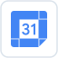

# NMKING 外掛市集

供 Codex 引入的 Git 市集。**一項服務、一個圖示、一個可獨立安裝的外掛。**
目前有 13 項服務；每個外掛只包含自己的 NMKING 操作指南、服務規格與圖示。

這一版先拆分圖示與安裝單位，**仍是 Skill 指南外掛，不是預先設定好的 MCP 連接器**。
安裝不會啟用 MCP、不會安裝其他服務，也不會替使用者完成帳號授權。
Codex 會依使用者選擇，再協助設定 MCP 或 CLI。

## 加入市集

在 Codex「外掛程式 → 新增外掛市集」填入：

| 欄位 | 內容 |
| --- | --- |
| 來源 | `youjunjer/nmking-plugins` |
| Git 參照 | `main`；固定版本可用 `v0.2.0` |
| 稀疏路徑 | 留空 |

加入後選擇 **NMKING 外掛市集**，只安裝需要的服務。不要只取
`plugins/nmking-connect`，那是舊版整合包；若使用稀疏路徑，需包含
`.agents/plugins` 及所需的個別外掛目錄。

支援相關命令的 Codex CLI 也可使用，例如只安裝 Padlet：

```sh
codex plugin marketplace add youjunjer/nmking-plugins --ref main
codex plugin add nmking-padlet@nmking-plugins
```

已加入 `main` 市集時，先更新清單：

```sh
codex plugin marketplace upgrade nmking-plugins
```

固定在 `v0.1.0` 或 `v0.1.1` 的 Git 參照需改成 `main` 或 `v0.2.0`，
才會取得新的 13 項服務清單。

## 13 項服務

| 圖示 | 服務 | 獨立外掛名稱 |
| --- | --- | --- |
|  | [Canva](plugins/nmking-canva/README.md) | `nmking-canva` |
|  | [GitHub](plugins/nmking-github/README.md) | `nmking-github` |
|  | [Notion](plugins/nmking-notion/README.md) | `nmking-notion` |
|  | [Padlet](plugins/nmking-padlet/README.md) | `nmking-padlet` |
|  | [Kahoot!](plugins/nmking-kahoot/README.md) | `nmking-kahoot` |
|  | [Vercel](plugins/nmking-vercel/README.md) | `nmking-vercel` |
|  | [Netlify](plugins/nmking-netlify/README.md) | `nmking-netlify` |
|  | [Cloudflare](plugins/nmking-cloudflare/README.md) | `nmking-cloudflare` |
|  | [Google Colab](plugins/nmking-colab/README.md) | `nmking-colab` |
|  | [Google Classroom](plugins/nmking-google-classroom/README.md) | `nmking-google-classroom` |
|  | [Google Drive](plugins/nmking-google-drive/README.md) | `nmking-google-drive` |
|  | [Google Calendar](plugins/nmking-google-calendar/README.md) | `nmking-google-calendar` |
|  | [Gmail](plugins/nmking-gmail/README.md) | `nmking-gmail` |

例如安裝 Padlet 後，在新對話輸入：

> 使用 Padlet 連線指南幫我連接 Padlet。沿用正確既有連線；需要新增或擴大權限時，先讓我確認。

Google Classroom／Drive／Calendar／Gmail 的此方案由 **Composio 第三方 MCP** 提供，
不是 Google 官方 MCP。歷史測試結果與限制完整保留，不能當成新使用者已登入或所有功能都已測試成功。

## 新增與更新

往後新服務一律建立獨立外掛。各自管理版本、圖示、Skill、服務文件與未來可能加入的 MCP 設定；
不再只加進舊版總覽。請看 [新增服務規則](docs/ADDING_A_SERVICE.md)。

使用 Node.js 20.19 以上版本，不需 npm 相依套件：

```sh
npm run build:services
npm test
npm run check
```

平常建置與檢查不連網、不執行帳號授權。`catalog/services.json` 控制主清單與每個服務的版本；
每個外掛自己的 `references/service.md`、`service.json` 是文件來源，建置不會從舊包覆寫它們。
只修改某項服務時，僅提高該服務版本，再建置與驗證。

`sync:connect` 是舊版整合包的公開文件匯入器，不會發布到各獨立外掛。
不要為了更新文件而改寫原有 `tested_on`、執行 Google 授權或重跑真實資源測試。

## 舊版與來源

舊版 [NMKING Connect 整合包](plugins/nmking-connect/) 與固定標籤 `v0.1.0`、`v0.1.1` 保留，
但新版主清單只列 13 項個別服務，不多放一個整合入口。不會替使用者解除安裝舊包。
需要舊整合包時可使用原固定版本；新使用者請選個別服務。

- [原始網頁連線規格](https://ai.nmking.io/connect)
- [圖示來源與授權](third_party/simple-icons/README.md)

本儲存庫是 **使用者自行加入的自訂市集**，不是 OpenAI 內建公開目錄的上架／審查結果。
所有指南由 NMKING 整理，非第三方服務供應商官方外掛；品牌名稱與商標屬各自權利人。

## 版本紀錄

- `0.2.0`：主市集拆為 13 個可獨立安裝的服務圖示；每個服務外掛初版為 `0.1.0`。
- `0.1.1`：補上舊整合包的清單、輸入區與 Skill 圖示。
- `0.1.0`：首次發布 13 項服務的整合指南。

## 聯絡

小霸王有限公司 · [NMKING AI Gateway](https://ai.nmking.io)

- LINE：[@nmkingtw](https://line.me/R/ti/p/%40nmkingtw)
- Email：nmkingtw@gmail.com
